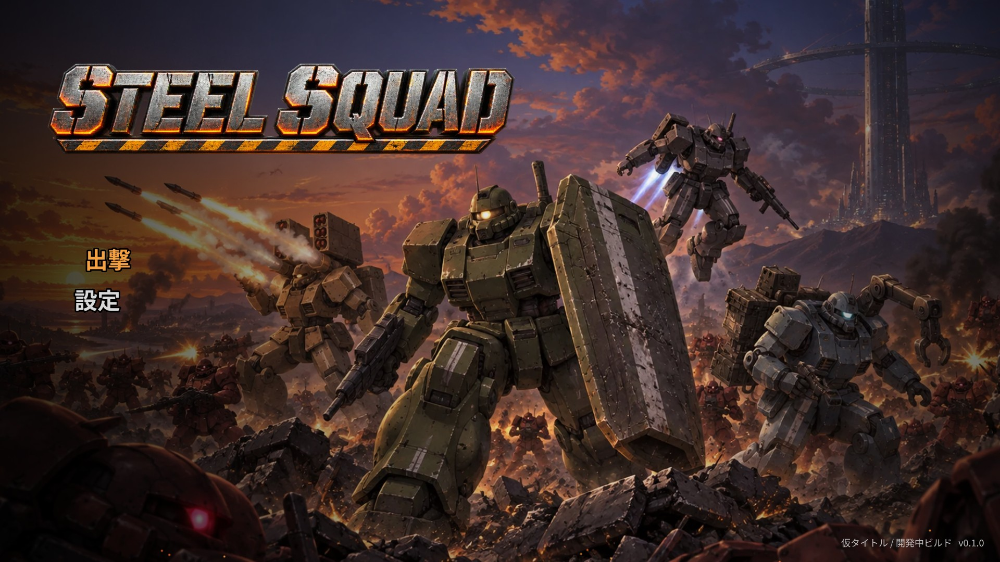

# STEEL SQUAD（仮タイトル）

90年代の家庭用ゲーム機で遊んだリアル系ロボットアクションを思わせる 2D 横スクロール・ロボットアクションを、**1〜4人の協力プレイ（同じ画面を共有）** で遊べるようにした試作です。
Steam での販売を目標に、遊べる 1 ステージ分（縦切り版 = vertical slice）を作りました。



## 遊び方

```bash
git clone https://github.com/Sinme52/STEEL-SQUAD.git
cd STEEL-SQUAD
npm install
npm run dev          # ブラウザで http://localhost:5173/ を開く
```

デスクトップ版（Steam 配布の形）で起動する場合:

```bash
npm run build
npm run electron     # --windowed を付けるとウィンドウ表示
```

配布用に書き出す場合（`release/` に出力）:

```bash
npm run dist:mac     # Windows は dist:win、Linux は dist:linux
```

書き出しに使う electron-builder は、通常の `npm install` では入れず、このときだけ `npx` で取得します。
electron-builder が使っている古いライブラリの警告（inflight / rimraf / glob / boolean）はこのときだけ表示されますが、配布物には含まれません。

### 操作

| 操作 | キーボード1 | キーボード2 | ゲームパッド |
|---|---|---|---|
| 移動 | A / D | ← / → | 左スティック |
| 照準（上下） | W / S | ↑ / ↓ | 右スティック（360度） |
| ジャンプ（長押しでホバー） | Space | 右Shift / Num0 | A |
| ブースト移動（押している間） | 左Shift | ' / Num4 | LB / 左スティック押し込み |
| 射撃 | J | , / Num1 | X / RT |
| 役割スキル | K | . / Num2 | Y / RB |
| 降機・搭乗・修理・スイッチ | L | / / Num3 | B |
| ポーズ | Esc | Enter | START |

- 部隊編成画面で、各自のジャンプボタンを押すと参加します（最大4人、ゲームパッドは自動認識）。
- 射撃ボタンを押している間は向きが固定されるので、後ろに下がりながら撃てます。
- 機体は重く、歩き出し・止まる・振り向くのに時間がかかります。急ぐときはブースト移動を使います。
  ブーストとホバーは同じゲージを使い、使い切るとオーバーヒートして半分回復するまで噴射できません。
  高い所から落ちると着地で一瞬動けなくなります。

## ゲームの中身

### 4つの役割

| 役割 | 機体 | 主武器 | スキル |
|---|---|---|---|
| アサルト（前衛） | BULWARK | 重機関銃 | **大盾**（長押し）: 正面の弾を防ぎ、後ろの仲間も守る。敵の攻撃が集まる |
| ストライカー（火力） | LONGBOW | 長砲身キャノン（爆風） | **誘導ミサイル6連射**。立ち止まると脚の支柱を下ろして威力アップ |
| スカウト（偵察） | WRAITH | 狙撃銃（貫通） | **索敵パルス**: 周囲の敵をマークし、被ダメージ 1.4 倍・画面外でも矢印表示。長いホバーと二段ジャンプ |
| サポート（支援） | TENDER | 短機関銃 | **修理ビーム**（長押し）: 仲間の機体・撃破された機体・パイロットを修理 |

### 往年のロボットアクションらしい要素

- **機体から降りられる**: パイロットは小さく脆いが、機体の通れない通気口をくぐれる。ステージ中盤のゲートは「誰かが降りてスイッチを押す」協力ギミック。
- **撃破されても終わりではない**: 機体が壊れるとパイロットが脱出。仲間（とくにサポート）が残骸を修理すれば復帰できる。パイロットが倒れると、増援が残っていれば降下ポッドで再出撃。
- **武器の熟練度**: 与えたダメージで武器レベル（最大5）が上がり、威力と連射が伸びる。セーブされ、次の出撃に引き継がれる。

### 共有画面のカメラ

全員が1つの画面に収まるようにズームし、離れすぎるとそれ以上は進めません（画面を分割しない）。進行方向を少し多めに映し、ボス戦では引いて全体を見せます。

### ステージ「OPERATION: IRON GATE」

前進 → ヘリ・戦車・砲台との戦闘 → ゲート（降機して通気口からスイッチ）→ 逆襲の撃退 → 高台の砲台地帯 → 闘技場で **多脚戦車ゴライアス** と対決。
ボスは体力に応じて3段階（主砲の照準線 → ミサイルの雨 → 踏みつけの衝撃波）。人数に応じて敵とボスの耐久が増えます。

## フォルダ構成

```
steel-squad/
  src/
    main.ts              起動と設定
    game/
      data.ts            役割・武器・敵のパラメータ（調整はここ）
      level.ts           地形と敵の出現
      player.ts          機体・パイロット・降機/搭乗/修理
      enemies.ts         量産機・戦車・ヘリ・砲台・ボス
      rig.ts             パーツ画像を組み合わせた機体アニメーション（IK歩行・照準・着地）
      shots.ts           弾・砲弾・ミサイル
      physics.ts         地形との当たり判定
      input.ts           キーボード2系統＋ゲームパッド4台
      audio.ts           効果音・BGM（Web Audio で合成。音声ファイルなし）
      i18n.ts            日本語 / English
      save.ts            設定と武器熟練度の保存
      steam.ts           Steam 実績（デスクトップ版のみ）
    scenes/              タイトル・部隊編成・ゲーム・HUD・背景・リザルト・設定
  electron/              デスクトップ版（Steam 配布用）
  public/assets/         ゲームで使う画像（加工済み）
  art-src/drafts/        gpt-image-2.5 で生成した元画像（WebP）とプロンプト記録（JSON）
  steam/                 ストアページ用の画像とスクリーンショット
  tools/                 画像の生成・加工、自動テスト
```

## 画像（gpt-image-2.5 スキルで生成）

すべての画像は gpt-image-2.5（品質 medium）で生成しました。プロンプトは `tools/gen_assets.py` にあります。

1. **機体**: 全身の参照画を作り、それを元に「同じ機体のパーツ分解図」（胴体・腕と武器・太もも・すね・足）を作成。
   `tools/process_assets.py` が透過部分でパーツを切り分け、関節の位置を推定して `src/game/rigs.json` を作ります。
   ゲーム内ではこのパーツを IK で動かして、歩行・照準・着地・撃破のアニメーションにしています。
2. **敵・ボス・背景・地形テクスチャ・パイロットの顔・キーアート・ロゴ**: 個別に生成。
3. **Steam 用画像**: `tools/steam_assets.py` がキーアートとロゴから各サイズのカプセル画像を合成します。

```bash
python3 tools/gen_assets.py              # まだ無い画像だけ生成（OPENAI_IMAGE_API_KEY が必要）
python3 tools/gen_assets.py keyart logo  # 指定した画像だけ作り直す
python3 tools/process_assets.py --preview  # ゲーム用に加工（リグの確認画像も出す）
python3 tools/steam_assets.py            # Steam 用画像を作る
```

リリース用に xhigh 品質で仕上げたい場合は、スキルの release コマンドに `art-src/drafts/` の画像を渡せます（同じ名前の JSON にプロンプトが残っています）。

## テスト

```bash
npm run dev &
node tools/playtest.cjs   # タイトル→部隊編成→出撃を実際のキー入力で通す
node tools/scenario.cjs   # 4人出撃・盾・ゲート・撃破と修理・ボス・リザルトへ直接飛んで確認
node tools/showcase.cjs   # 1920x1080 のスクリーンショット（WebGL）
```

GPU の無い環境では `?canvas` を付けた URL で、キャンバス描画で動かせます（色味の一部が省略されます）。

## Steam 販売までに残っていること

今あるのは「1ステージを最初から最後まで遊べる縦切り版」です。販売までには次が必要です。

**内容の量**
- ステージを 6〜8 本に増やす（雪原・市街・軌道エレベーター内部など）と、ステージ間の物語（傭兵部隊のブリーフィング）
- 敵の種類（重装機・飛行型・歩兵）と、ボスを各ステージに
- 機体のカスタマイズ（武器の付け替え・パーツ購入）と、ステージ間の格納庫画面

**遊びの質**
- 実際の人による遊び込みと難易度調整（今は数値を机上で決めた段階）
- 人数が少ないときの AI 僚機
- キー割り当ての変更、色覚に配慮した表示、字幕・文字サイズの設定
- 本物のゲームパッドでの確認（自動テストではキーボードのみ確認済み）

**オンライン**
- 同じ画面を共有する作りなので、まずは **Steam Remote Play Together** でオンライン協力ができます（追加開発なし）
- 本格的なオンライン対応をするなら Steam Networking の導入が必要

**音**
- 効果音と BGM は Web Audio の合成で仮に作っています。販売版は作曲家・効果音素材への差し替えを推奨

**ストア・権利まわり**
- Steamworks への登録（App ID 取得、`steamworks.js` を入れると `electron/main.cjs` の実績連携が有効になる）
- 実績の Steamworks 側の登録（コード上は FIRST_CLEAR / GATE_OPENED / FIELD_REPAIR / NO_CASUALTIES / FULL_SQUAD / WEAPON_MASTER）
- **タイトルの商標確認**（「STEEL SQUAD」は仮。同名の作品がないか要確認）
- **生成画像の権利・類似性の確認**: AI 生成のため、既存作品（特にロボットアニメ）のデザインに似すぎていないか、販売前に人の目で確認すること。モノアイの敵機など、定番の意匠が混ざっています。必要ならデザイナーによる描き直しや、生成画像を下敷きにした清書を推奨します。Steam では AI 生成コンテンツの使用申告も必要です
- フォント（Noto Sans JP / Rajdhani、どちらも SIL OFL）のライセンス表記をクレジットに追加
